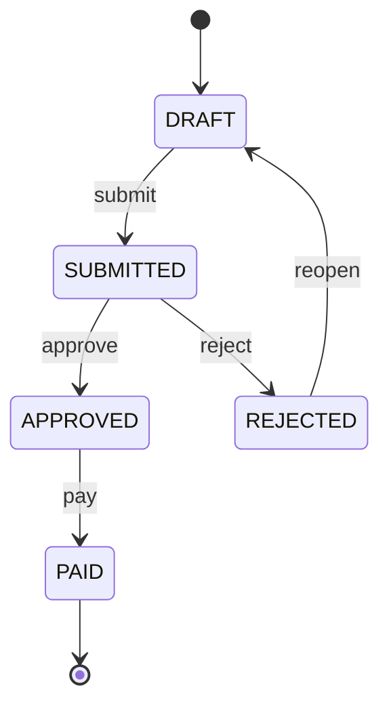
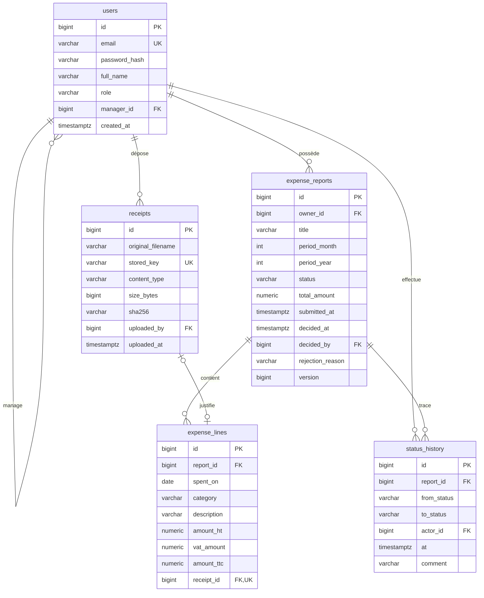

# ExpenseFlow

API REST de gestion des notes de frais : un employé saisit ses dépenses du mois avec leurs justificatifs, son manager approuve ou rejette la note, le service comptable la marque comme payée.

[](https://github.com/misterOumar/expenseflow/actions/workflows/ci.yml)


---

## Sommaire

- [Fonctionnalités](#fonctionnalités)
- [Stack technique](#stack-technique)
- [Démarrage local](#démarrage-local)
- [Configuration](#configuration)
- [Tests](#tests)
- [Déploiement](#déploiement)
- [Workflow d'une note](#workflow-dune-note)
- [API](#api)
- [Modèle de données](#modèle-de-données)
- [Exigences techniques](#exigences-techniques)
- [Organisation du code](#organisation-du-code)

---

## Fonctionnalités

- **Authentification JWT** : connexion par email et mot de passe (BCrypt), jeton valable 24 h.
- **Trois rôles** : employé, manager, comptable, avec un contrôle d'accès au niveau de chaque note.
- **Notes de frais mensuelles** : une note par employé et par mois, des lignes catégorisées (HT, TVA, TTC calculé), un total recalculé à chaque modification.
- **Workflow de validation** : soumission, approbation ou rejet motivé, réouverture, paiement. Chaque transition est tracée dans un historique.
- **Justificatifs** : upload PDF, JPEG ou PNG (5 Mo maximum), avec vérification du contenu réel du fichier et téléchargement soumis aux droits d'accès.
- **Export PDF** : récapitulatif d'une note approuvée ou payée, généré à la volée.
- **Notifications email** : envoyées au destinataire concerné à la soumission, à l'approbation et au rejet.
- **Jeu de démonstration** : comptes et notes dans chaque statut, chargés par Flyway.

## Stack technique

| Couche | Choix |
|---|---|
| Langage | Java 21 |
| Framework | Spring Boot 4.1 (Web MVC, Data JPA, Security, Validation, Mail) |
| Base de données | PostgreSQL 16, migrations Flyway |
| Sécurité | Spring Security, OAuth2 Resource Server (JWT HS256) |
| Mapping | MapStruct |
| PDF | Apache PDFBox 3 |
| Documentation API | springdoc-openapi (Swagger UI) |
| Tests | JUnit 5, Mockito, MockMvc, Testcontainers |
| Build | Maven |
| Livraison | Docker, GitHub Actions, Coolify |

## Démarrage local

### Prérequis

- Java 21
- Docker (base de données et tests d'intégration)
- Un serveur SMTP de développement pour consulter les emails, par exemple [Mailpit](https://mailpit.axllent.org/) (SMTP sur le port `1025`, interface web sur `8025`). Sans serveur SMTP, l'application fonctionne normalement : les échecs d'envoi sont simplement journalisés.

### Lancement

```bash
# 1. Base PostgreSQL (port 5433)
docker compose up -d

# 2. Serveur SMTP de développement (optionnel)
docker run -d --name mailpit -p 1025:1025 -p 8025:8025 axllent/mailpit

# 3. Application (port 8080)
./mvnw spring-boot:run
```

Flyway crée le schéma et charge le jeu de démonstration au démarrage.

| Service | URL |
|---|---|
| Swagger UI | http://localhost:8080/swagger-ui.html |
| Spécification OpenAPI | http://localhost:8080/v3/api-docs |
| État de santé | http://localhost:8080/actuator/health |
| Emails (Mailpit) | http://localhost:8025 |

### Comptes de démonstration

Mot de passe commun : `password`

| Email | Rôle | Manager |
|---|---|---|
| `manager@expenseflow.dev` | MANAGER | - |
| `compta@expenseflow.dev` | ACCOUNTANT | - |
| `alice@expenseflow.dev` | EMPLOYEE | manager |
| `bob@expenseflow.dev` | EMPLOYEE | manager |
| `chloe@expenseflow.dev` | EMPLOYEE | manager |

### Notes de démonstration

| Employé | Note | Période | Statut |
|---|---|---|---|
| Alice | Salon VivaTech Paris | 06/2026 | `PAID` |
| Alice | Rendez-vous clients | 07/2026 | `SUBMITTED` |
| Alice | Fournitures | 10/2026 | `DRAFT` (ligne sans justificatif) |
| Bob | Formation Kubernetes | 07/2026 | `APPROVED` |
| Bob | Mission Bordeaux | 08/2026 | `REJECTED` |
| Chloé | Visite fournisseur Lille | 08/2026 | `SUBMITTED` |
| Chloé | Séminaire équipe | 07/2026 | `DRAFT` (rejetée puis rouverte) |

Chaque note possède ses lignes et son historique de transitions. Les justificatifs de démonstration n'existent qu'en base : leur téléchargement renvoie `404`.

Quelques parcours à tester :

- `manager@expenseflow.dev` : `GET /api/reports?status=SUBMITTED`, puis `approve` ou `reject` sur l'une des notes ;
- `compta@expenseflow.dev` : `pay` sur « Formation Kubernetes », puis `export.pdf` ;
- `alice@expenseflow.dev` : déposer un justificatif, l'ajouter à une ligne de « Fournitures », puis `submit`.

### Premier appel

```bash
TOKEN=$(curl -s -H 'Content-Type: application/json' \
  -d '{"email":"alice@expenseflow.dev","password":"password"}' \
  http://localhost:8080/api/auth/login | jq -r .accessToken)

curl -H "Authorization: Bearer $TOKEN" http://localhost:8080/api/reports
```

Dans Swagger UI, le bouton **Authorize** accepte le jeton retourné par `POST /api/auth/login`.

## Configuration

Les valeurs par défaut conviennent au développement local. En production, elles se surchargent par variables d'environnement.

| Variable | Défaut | Rôle |
|---|---|---|
| `JWT_SECRET` | clé de développement | Clé HMAC des jetons, encodée en Base64, 256 bits minimum. **À définir en production.** |
| `RECEIPTS_DIR` | `./data/receipts` | Répertoire de stockage des justificatifs |
| `MAIL_HOST` / `MAIL_PORT` | `localhost` / `1025` | Serveur SMTP |
| `MAIL_USERNAME` / `MAIL_PASSWORD` | vides | Authentification SMTP |
| `MAIL_FROM` | `ExpenseFlow <noreply@expenseflow.dev>` | Expéditeur des notifications |
| `SERVER_FORWARD_HEADERS_STRATEGY` | aucune | `framework` derrière un reverse proxy HTTPS |

La connexion PostgreSQL se configure avec les propriétés Spring Boot standard (`SPRING_DATASOURCE_URL`, `SPRING_DATASOURCE_USERNAME`, `SPRING_DATASOURCE_PASSWORD`).

Pour générer un secret JWT :

```bash
openssl rand -base64 32
```

## Tests

```bash
./mvnw test
```

Docker doit être démarré : les tests d'intégration lancent un PostgreSQL éphémère via Testcontainers et y appliquent les migrations Flyway, comme en production. L'envoi d'emails est simulé.

| Suite | Couverture |
|---|---|
| `WorkflowIntegrationTest` | Chaque transition : cas nominal, transitions interdites (`409`), mauvais acteur (`403`), note d'un autre employé (`404`), manager approuvant sa propre note |
| `ReportListIntegrationTest` | Filtrage de la liste par rôle et par statut, absence de requêtes N+1 |
| `ReceiptIntegrationTest` | Formats acceptés et refusés, fichier déguisé, taille maximale, droits de téléchargement |
| `ReportMailIntegrationTest` | Destinataires et contenu des emails, aucun email en cas de rollback ou de transition refusée, panne SMTP sans impact sur la transition |
| `ReportPdfIntegrationTest`, `ReportPdfRendererTest` | Contenu du PDF, pagination, caractères non imprimables |
| `AuthIntegrationTest` | Connexion, identifiants invalides, jeton absent ou falsifié, sonde de santé publique |
| `ReportStatusTest` | Les 25 combinaisons du graphe de statuts |
| `DemoDataMigrationTest` | Cohérence du jeu de démonstration : rôles, statuts, totaux, justificatifs, historique |

## Déploiement

### Image Docker

Le `Dockerfile` produit une image en deux étapes :

- **build** : compilation Maven, puis découpage du jar en couches Spring Boot (dépendances, loader, application). Une modification du code ne reconstruit que la dernière couche ;
- **exécution** : JRE 21 Alpine seul, utilisateur sans privilèges, justificatifs dans le volume `/data/receipts`, healthcheck sur `/actuator/health/readiness`.

```bash
docker build -t expenseflow .
```

### Stack complète

`compose.prod.yaml` décrit l'environnement en ligne : l'API, PostgreSQL et Mailpit, avec des volumes persistants pour la base et les justificatifs. L'API ne démarre qu'une fois la base prête, et Flyway applique les migrations au démarrage.

```bash
export POSTGRES_PASSWORD=$(openssl rand -base64 24)
export JWT_SECRET=$(openssl rand -base64 32)
docker compose -f compose.prod.yaml up -d --build
```

`POSTGRES_PASSWORD` et `JWT_SECRET` sont obligatoires : le démarrage échoue sans eux. Les variables `MAIL_*` permettent de remplacer Mailpit par un serveur SMTP réel.

### Coolify

1. Créer une ressource à partir du dépôt Git, avec le build pack **Docker Compose** et le fichier `compose.prod.yaml`.
2. Renseigner `POSTGRES_PASSWORD` et `JWT_SECRET` dans les variables d'environnement.
3. Attribuer un domaine au service `app` (port `8080`) et, si besoin, au service `mailpit` (port `8025`) pour consulter les emails envoyés. L'interface Mailpit n'a pas d'authentification par défaut.
4. Déployer. Le reverse proxy de Coolify termine le HTTPS ; l'application en tient compte (`SERVER_FORWARD_HEADERS_STRATEGY=framework`) pour générer des URL publiques correctes.

### Intégration continue

Le workflow GitHub Actions (`.github/workflows/ci.yml`) s'exécute à chaque push sur `main` et sur chaque pull request :

1. **Build et tests** : `./mvnw verify`, tests Testcontainers compris. Les rapports sont publiés en artefact en cas d'échec.
2. **Image Docker** : construction de l'image pour valider le `Dockerfile`, avec cache des couches.

## Workflow d'une note



| Action | Acteur autorisé | Conditions |
|---|---|---|
| `submit` | Propriétaire | Au moins une ligne, chaque ligne a un justificatif |
| `approve` | Manager du propriétaire | Le valideur n'est pas le propriétaire |
| `reject` | Manager du propriétaire | Motif de 10 caractères minimum |
| `reopen` | Propriétaire | - |
| `pay` | Comptable | - |

Une note n'est modifiable qu'en `DRAFT`. Chaque transition enregistre une entrée d'historique (statut avant et après, auteur, horodatage, commentaire).

Les contrôles sont appliqués dans cet ordre, chacun avec son code HTTP :

1. **Visibilité** (`404`) : une note qu'on ne peut pas consulter est traitée comme inexistante, pour ne pas révéler son existence.
2. **Acteur** (`403`) : l'utilisateur voit la note mais n'est pas habilité à cette action.
3. **État** (`409`) : la transition est incompatible avec le statut courant ou les règles métier. Ces règles sont portées par l'entité `ExpenseReport`.

Une note est visible par son propriétaire, par le manager de celui-ci, et par les comptables une fois approuvée ou payée.

## API

Toutes les routes sont préfixées par `/api` et exigent un jeton JWT, sauf la connexion. La sonde `GET /actuator/health` est publique et ne renvoie que l'état global. Les erreurs sont renvoyées au format [ProblemDetail (RFC 9457)](https://www.rfc-editor.org/rfc/rfc9457), sans stack trace.

| Méthode | Route | Description |
|---|---|---|
| `POST` | `/api/auth/login` | Connexion, retourne un JWT |
| `GET` | `/api/reports?status=` | Notes visibles selon le rôle, filtre optionnel par statut |
| `POST` | `/api/reports` | Création d'un brouillon |
| `GET` | `/api/reports/{id}` | Détail d'une note et de ses lignes |
| `PUT` | `/api/reports/{id}` | Modification d'un brouillon |
| `DELETE` | `/api/reports/{id}` | Suppression d'un brouillon |
| `POST` | `/api/reports/{id}/lines` | Ajout d'une ligne |
| `PUT` | `/api/reports/{id}/lines/{lineId}` | Modification d'une ligne |
| `DELETE` | `/api/reports/{id}/lines/{lineId}` | Suppression d'une ligne |
| `POST` | `/api/reports/{id}/submit` | `DRAFT` → `SUBMITTED` |
| `POST` | `/api/reports/{id}/approve` | `SUBMITTED` → `APPROVED` |
| `POST` | `/api/reports/{id}/reject` | `SUBMITTED` → `REJECTED`, corps : `{ "reason": "..." }` |
| `POST` | `/api/reports/{id}/reopen` | `REJECTED` → `DRAFT` |
| `POST` | `/api/reports/{id}/pay` | `APPROVED` → `PAID` |
| `GET` | `/api/reports/{id}/history` | Historique des transitions |
| `GET` | `/api/reports/{id}/export.pdf` | Récapitulatif PDF (note `APPROVED` ou `PAID`) |
| `POST` | `/api/receipts` | Upload d'un justificatif (multipart, champ `file`) |
| `GET` | `/api/receipts/{id}` | Téléchargement d'un justificatif |

Les transitions sont exposées par des endpoints d'action dédiés plutôt que par une modification du champ `status` : chaque action porte une intention métier explicite et sa propre règle d'autorisation.

## Modèle de données



**Choix de conception**

- **Montants** en `NUMERIC(12,2)`, mappés en `BigDecimal`. Aucun type flottant.
- **Verrouillage optimiste** : la colonne `version` de `expense_reports` fait échouer en `409` la seconde de deux modifications concurrentes (par exemple deux décisions simultanées sur la même note).
- **Intégrité en base** : unicité `(owner_id, period_month, period_year)`, un justificatif par ligne, contraintes `CHECK` sur les énumérations, les bornes de période, `amount_ttc = amount_ht + vat_amount`, ainsi que le type et la taille des justificatifs.
- **Schéma versionné** exclusivement par Flyway (`src/main/resources/db/migration`). Hibernate se limite à valider le schéma (`ddl-auto: validate`).

## Exigences techniques

### 1. Performance des requêtes : pas de N+1

**Problème.** La liste des notes affiche le nom du propriétaire de chacune. Avec une association `owner` chargée à la demande (`LAZY`), Hibernate exécute une requête supplémentaire par propriétaire distinct au moment du mapping en DTO : le nombre de requêtes croît avec le nombre de notes.

**Solution.** La requête de liste (`ExpenseReportRepository.findVisible`) charge le propriétaire dans la même requête, par une jointure :

```java
@EntityGraph(attributePaths = "owner")
@Query("select r from ExpenseReport r where ...")
List<ExpenseReport> findVisible(...);
```

**Mesure.** Le nombre de requêtes SQL est compté avec les statistiques Hibernate (`hibernate.generate_statistics`) lors de l'appel de `GET /api/reports` par un manager voyant 4 notes appartenant à 4 utilisateurs différents :

| | Requêtes SQL |
|---|---|
| Sans `@EntityGraph` | **5** : utilisateur courant + liste + 3 propriétaires (le 4ᵉ, le manager lui-même, est déjà en session) |
| Avec `@EntityGraph` | **2** : utilisateur courant + liste avec jointure, quel que soit le nombre de notes |

Le test `ReportListIntegrationTest.listDoesNotTriggerNPlusOne` vérifie ce chiffre de 2 : toute régression fait échouer la build.

### 2. Envoi des emails après commit

**Problème.** Un appel réseau à l'intérieur d'une transaction pose deux problèmes :

- un serveur SMTP lent immobilise la connexion à la base pendant toute la durée de l'envoi, ce qui peut épuiser le pool de connexions ;
- si la transaction est annulée après l'envoi (conflit de version, contrainte violée), l'email annonce une décision qui n'existe pas, et il ne peut pas être rappelé.

**Solution.** Le service publie un événement, et l'envoi n'a lieu qu'une fois la transaction validée :

```
ReportService.transition()                Spring                       ReportMailListener
BEGIN
  UPDATE note, INSERT historique
  publishEvent(ReportStatusChanged) ───►  conserve l'événement
COMMIT ✔ ──────────────────────────────►  le transmet ──────────────►  envoie l'email
ROLLBACK ✘ ────────────────────────────►  l'abandonne : aucun email
```

- `ReportService` publie un `ReportStatusChanged` et ignore tout de l'envoi d'emails.
- `ReportMailListener` est annoté `@TransactionalEventListener(phase = AFTER_COMMIT)`.
- `@Async` exécute l'envoi sur un autre thread : un serveur SMTP lent ne retarde pas la réponse HTTP, et une panne SMTP est journalisée sans transformer en erreur une transition déjà enregistrée.
- L'événement est un `record` de valeurs simples, sans entité JPA : il est traité après la fermeture de la session Hibernate.

`ReportMailIntegrationTest.noMailOnRollback` publie un événement dans une transaction annulée et vérifie qu'aucun email n'est envoyé. Ce test échoue si l'écouteur est remplacé par un `@EventListener` classique.

### 3. Sécurité de l'upload

Le nom de fichier, l'extension et le `Content-Type` fournis par le client ne sont pas considérés comme fiables.

| Mesure | Implémentation | Attaque bloquée |
|---|---|---|
| Vérification des magic bytes | `ReceiptFileType.detect` identifie le format d'après les premiers octets (`%PDF-`, `FF D8 FF`, `89 PNG`) et ignore le `Content-Type` déclaré | Fichier HTML ou exécutable renommé en `.pdf` (`415`) |
| Liste blanche d'extensions | L'extension doit correspondre au format détecté (`pdf`, `jpg`, `jpeg`, `png`) | Extension trompeuse ou incohérente (`415`) |
| Nom de stockage généré | Fichier enregistré sous un UUID. Le nom d'origine, réduit à son dernier segment, ne sert qu'à l'affichage | Traversée de répertoire (`../`), écrasement, URL devinable |
| Stockage hors du répertoire public | Répertoire dédié (`RECEIPTS_DIR`), jamais servi statiquement. `ReceiptStorage` n'accepte qu'une clé au format UUID et vérifie que le chemin résolu reste dans ce répertoire | Accès direct au fichier |
| Plafond de taille | 5 Mo, appliqué par le conteneur de servlets puis revérifié par le service (`413`) | Saturation du disque ou de la mémoire |
| Accès contrôlé | `GET /api/receipts/{id}` n'est autorisé qu'à l'auteur du dépôt et aux personnes habilitées à consulter la note associée (`404` sinon). Réponse en `attachment` avec `X-Content-Type-Options: nosniff` | Lecture des justificatifs d'autrui, exécution de contenu dans le navigateur |

Le fichier est écrit sur disque avant l'insertion en base. Si la transaction échoue, une `TransactionSynchronization` le supprime pour ne laisser aucun fichier orphelin.

## Organisation du code

```
src/main/java/dev/misteroumar/expenseflow
├── auth/           Connexion et émission des JWT
├── security/       Configuration Spring Security, décodage des JWT, réponses 401/403
├── user/           Utilisateurs et rôles
├── report/         Notes, lignes, workflow, historique, export PDF
├── receipt/        Upload, stockage et téléchargement des justificatifs
├── notification/   Emails envoyés après commit
└── common/         Gestion globale des erreurs, OpenAPI, exécution asynchrone
```

À la racine : `Dockerfile`, `compose.yaml` (base de développement), `compose.prod.yaml` (stack de déploiement) et `.github/workflows/ci.yml`.

Les entités JPA ne sont jamais exposées : l'API reçoit et renvoie des DTO, convertis par MapStruct et validés par Bean Validation.
